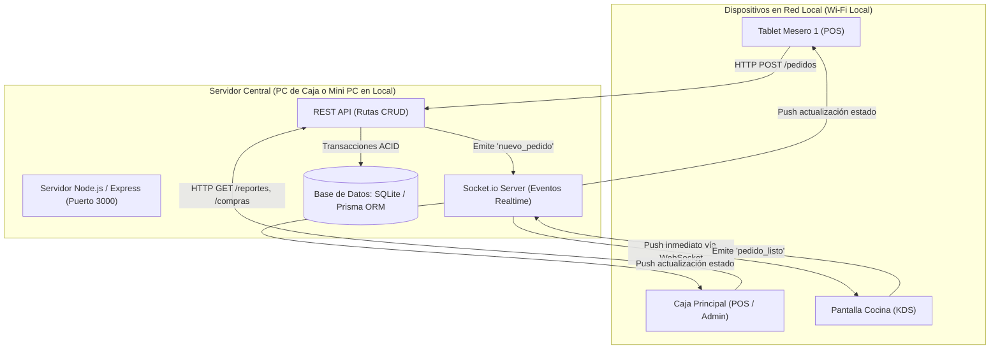
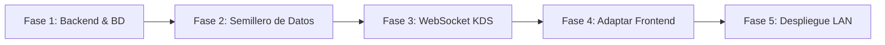

# Plan de Migración: ERP/POS a Red Local (On-Premise)

> [!IMPORTANT]
> **Objetivo:** Convertir la aplicación actual (monolito frontend con `localStorage`) en una arquitectura cliente-servidor para red local (LAN/Wi-Fi del local). Permitirá que múltiples dispositivos (caja, tablets de meseros y pantalla KDS de cocina) compartan una base de datos única y sincronicen pedidos en milisegundos mediante WebSockets, funcionando incluso sin conexión a internet.

---

## 1. Arquitectura Propuesta

### ¿Por qué SQLite + Prisma + Socket.io para este caso?
1. **SQLite (con Prisma ORM):**
   * Es un único archivo en disco (`data/database.sqlite`), sin necesidad de instalar o mantener servicios pesados como PostgreSQL o MySQL.
   * Fácil de respaldar: copiar el archivo `.sqlite` a una memoria USB o Drive genera una copia de seguridad completa del restaurante.
   * Soporta soporte transaccional ACID con excelente rendimiento para cientos de pedidos diarios.
2. **Socket.io (WebSockets):**
   * Comunicación bidireccional instantánea: en cuanto un mesero presiona "Enviar a Cocina", la comanda suena y aparece en la pantalla KDS sin recargar la página.
3. **Autonomía 100% Offline:**
   * La fuente de soda sigue operando con total normalidad aunque se caiga el proveedor de internet residencial.

---

## 2. Fases de la Migración

### Fase 1: Creación del Servidor Backend
* Crear una subcarpeta `/server` o un módulo backend ligero con Node.js + Express + TypeScript.
* Configurar **Prisma ORM** con SQLite.
* Definir el modelo de datos relacional para sustituir los tipos de `src/types/index.ts`:
  * `Ingredient` (con stock actual y costo promedio ponderado).
  * `Product` / `Recipe` / `RecipeItem` (escandallos y relación insumo-producto).
  * `Order` / `OrderItem` (pedidos de mesa, salón, delivery).
  * `KardexMovement` (registro transaccional inmutable de entradas y salidas).
  * `Invoice` / `PurchaseOrder` / `Supplier` (compras y proveedores).
  * `Table` (estado de mesas: libre, ocupada, por cobrar).

### Fase 2: Migración y Semillero de Datos Existentes
* Crear un script (`seed.ts`) que tome los datos preconfigurados en `src/data/` (`menuConfig.ts`, `initialInventory.ts`, `initialSuppliers.ts`, etc.) e inicialice la base de datos SQLite con los datos base de la juguería.
* Opcional: Generar un botón en la interfaz para "Exportar datos actuales de localStorage hacia el servidor".

### Fase 3: Capa de Tiempo Real (Socket.io)
* Implementar canales y eventos en el servidor:
  * `order:created`: Cuando el mesero crea un pedido $\rightarrow$ se notifica a cocina y caja.
  * `order:status_changed`: Cuando cocina marca el pedido como "Listo" o "En preparación".
  * `table:status_changed`: Cambia de color la mesa en el mapa de salón de todos los meseros.
  * `stock:warning`: Alerta a los meseros si un insumo se agotó para no seguir vendiéndolo.

### Fase 4: Adaptación del Frontend (`src/context/AppContext.tsx`)
* Reemplazar las lecturas directas de `localStorage.getItem` y escrituras `localStorage.setItem` por:
  1. Un cliente API (`src/services/api.ts`) usando `fetch` o `axios`.
  2. Un hook/servicio de Socket.io (`src/services/socket.ts`) que escuche eventos en segundo plano y actualice el estado de React en memoria.
* Mantener la misma interfaz de funciones en `AppContext` (`addOrder`, `updateStock`, `registerPurchase`) para no tener que reescribir ninguno de los 14 componentes del ERP.

### Fase 5: Configuración de Red Local y Puesta en Marcha
* Asignar una IP estática local al equipo servidor (ej. `192.168.1.100`).
* Configurar la aplicación para servirse desde el puerto 3000 o mediante un script de inicio en Windows (`pm2` o acceso directo).
* Dispositivos clientes entran desde su navegador (Chrome/Safari) a: `http://192.168.1.100:3000`.

---

## 3. Matriz de Entidades: Antes vs. Después

| Entidad | Estado Actual (`localStorage`) | Nuevo Estado (Red Local) |
| :--- | :--- | :--- |
| **Recetas y Menú** | JSON estático modificado localmente | Tabla `products` y `recipes` en SQLite |
| **Insumos y Stock** | Variable local; desincronizada entre tablets | Tabla `ingredients` centralizada con transacciones atómicas |
| **Kárdex** | Reconstruido al vuelo en el navegador | Tabla relacional indexada `kardex_movements` |
| **Comandas a Cocina** | No viajan entre dispositivos | Evento Socket.io push instantáneo a `KdsModule` |
| **Mesas** | Estado aislado por pantalla | Sincronización en vivo del estado de mesas |
| **Respaldo** | Se pierde si se limpia caché | Copia de archivo `database.sqlite` |

